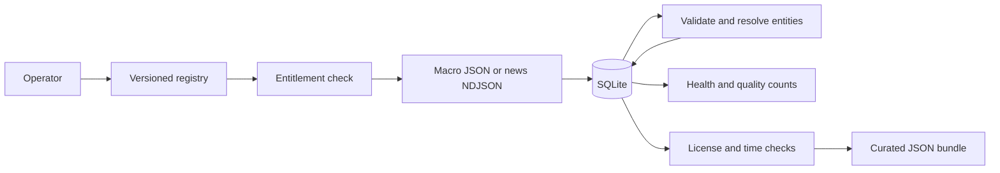

# Architecture and data contracts

## Local deployment

One operator process can handle both sources. The archive, records and checkpoints share a database so a page can commit atomically. A successful transaction stores exact provider bytes by SHA-256, appends a timestamped receipt, records accepted rows and quality issues, and advances the source cursor. SQLite serializes writers. Fetches and retry sleeps happen outside the transaction. A second worker rechecks both the active policy version and the cursor before saving a page. The append-only tables have update/delete guards. The machine owner remains trusted.

The project began with only the implementation plan. Both fixtures and adapters were written here. The local storage and JSON packaging choices keep setup offline. Object storage, Parquet, PostgreSQL and service-to-service authentication are future integration decisions. The producer boundary is the adapter contract below. The consumer boundary is the versioned JSON bundle.

## Registry v1

`apply-registry` installs a complete source map. Both the registry and provider manifests have schema version 1. Every policy change needs a higher integer registry version. Reapplying identical content is idempotent. Each source has a stable ID, immutable connector kind, enabled flag, exclusive UTC license expiry, license ID and terms, declared provenance, allowed export purposes and alias map. Macro sources also map each series to its unit. Tokens start with an ASCII alphanumeric character and may contain dots, hyphens and underscores.

An enabled, unexpired entry grants the operator collection rights for these synthetic feeds. Omitting or disabling a source revokes collection and export. Health and internal receipts remain available to the operator. Purpose permissions are checked at export against both the current policy and the policy captured with each selected record. The latter must also be unexpired. An unauthorized selection fails the whole request. Export decisions use the policy snapshot at the start of the read transaction.

## Connector v1

Construct an adapter with `(fixture_root, source_id, connector_kind)`. Implement three methods.

- `latest() -> int` returns a nondecreasing high-water mark. Zero denotes an empty feed.
- `fetch(sequence: int) -> bytes` returns one complete immutable page. Sequences start at 1. The fixture adapter reads `<root>/<source>/manifest.json` and numbered pages up to 4 MiB. Each manifest contains `schema_version` and `latest`. A missing advertised page blocks advancement.
- `decode(raw: bytes) -> list` parses a complete page. Macro expects a JSON object with an `observations` array. News expects one UTF-8 JSON object per nonblank line. Invalid JSON, duplicate object keys and invalid byte sequences reject the whole page. Parsed rows with invalid fields are quarantined individually. The 1-based ordinal counts parsed records.

A transient provider error raises `TemporaryFailure(code, detail, retry_after)`. The worker makes up to three attempts with delays of 0.25 and 0.5 seconds, or the provider's longer delay. A delay above 30 seconds returns control to the operator immediately. Other failures raise `Problem(code, detail)`. Applying a registry change mid-run requires a fresh run under the new version.

## Records and revisions

Both input types require `entity`, `event_at`, `published_at` and a positive integer `revision`. Optional `embargo_until` defaults to publication. Use ISO dates with a T separator, seconds, an explicit Z or numeric offset and at most six fractional digits. Output uses fixed-width UTC microseconds. Entities resolve by trimming and case-folding source-specific aliases. Unknown and ambiguous aliases produce quality issues.

- A macro observation supplies `series`, `unit`, and `value` as a decimal string or JSON null. Null requires a nonempty `missing_reason`. Decimal strings avoid floating-point rounding. The logical key is the canonical JSON tuple of series, resolved entity and event time. The fixture uses index points.
- A news item supplies a stable publisher `article_id` and a nonempty `headline`. The article ID is its logical key. Transport metadata such as a delivery ID stays in the raw archive.
- Identity is source, logical key and revision. A repeated normalized row counts as a duplicate. A different row at the same identity creates a conflict issue. Only a new revision can change published content. Revisions can arrive out of order. Publishers must keep series units, entity identities and article IDs stable and issue a new revision for a correction.

Availability is the latest of the receipt, publication and embargo timestamps. For each logical key the default export selects the highest revision available at the requested cutoff. A request with `--history` includes all eligible revisions. Future cutoffs are rejected. A delayed ingestion can never make a value visible to an earlier query.

## Export v1

The UTF-8 JSON envelope includes `schema_version`, `as_of`, `exported_at`, `purpose`, `history`, `current_registry_version`, `licenses` and `records`. License entries are keyed by source and registry version. Each carries its ID, terms, purposes, expiry and provenance. They travel with the records.

Each record includes the normalized payload, `source`, `record_key`, `revision`, `entity_id`, event/publication/embargo times, `observed_at`, `available_at`, `registry_version`, `license_id`, page `sequence`, `ordinal` and `raw_sha256`. The sequence, ordinal and hash identify its exact archived input. Rows sort by source, logical key and descending revision. [Example bundles and health responses](../reports/demo.json)
