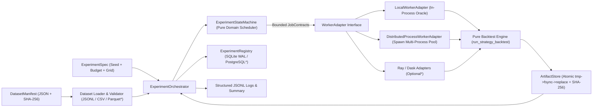

# Architecture

## Component Overview

The Distributed Quant Research Platform (`dqrp`) separates canonical contracts, pure domain logic, durable storage, and worker execution behind explicit typed boundaries.

*\*Optional external backends (`pyarrow`, `ray`, `dask`, `psycopg`) fail fast with `BackendUnavailableError` when not installed.*

## Data Flow

1. **Input Validation & Lineage Sealing:**
   - `DatasetManifest` is validated against `dqrp.v1`, every partition's byte length and SHA-256 digest are verified on disk, and every `MarketBar` is checked for `availability_time >= event_time` (preventing look-ahead leakage). Completeness ratio and max freshness lag (seconds) are recorded.
   - `ExperimentSpec` verifies `expected_dataset_sha256` (if pinned), deterministically expands parameter sets in sorted key order, derives per-trial 32-bit seeds from `(base_seed, spec_sha256, trial_index)`, and builds immutable `JobContract` records with content-addressed `input_sha256` and `trial_id`.

2. **Artifact Hygiene & Resume:**
   - Before dispatch, `ArtifactStore.sweep_partial_temp_files()` quarantines leftover `.tmp` files from prior crashes.
   - When `--resume` is enabled, pre-existing artifacts matching `(trial_id, input_sha256, sidecar_sha256)` are adopted as cache hits; tampered or truncated files are quarantined and scheduled for recomputation.

3. **Bounded Scheduling & Fault Handling:**
   - `ExperimentStateMachine` maintains pure state transitions (`PENDING`, `RUNNING`, `RETRY_WAIT`, `SUCCEEDED`, `FAILED`, `CANCELLED`, `SKIPPED_BUDGET`) with zero I/O.
   - In-flight tasks never exceed `min(workers, budget.max_concurrency)`.
   - Worker crashes (`WORKER_CRASH_ERROR`, including hard subprocess exits detected via `process.is_alive()` / `exitcode`) and partial artifact detections (`ARTIFACT_INTEGRITY_ERROR`) trigger bounded exponential retries up to `max_retries`.
   - Duplicate task submissions and duplicate completion deliveries are suppressed via `_completed_ids` and `_seen_completion_keys` sets.

4. **Budget Enforcement & Cooperative Cancellation:**
   - Before every dispatch and after every completion, the orchestrator checks `max_trials`, `max_cpu_seconds`, `max_wall_seconds`, `max_memory_mb`, and `max_estimated_cost_usd`.
   - Breaching any budget limit or receiving a cancellation signal transitions pending trials to `SKIPPED_BUDGET` / `CANCELLED` and cancels in-flight workers.

5. **Deterministic Aggregation & Registry Commit:**
   - Completed and terminal trial results are sorted strictly by `(trial_index, trial_id)` independent of worker finish order.
   - `aggregate_sha256` is computed over the canonical JSON of backend-independent `logical_payload()` fields (`trial_id`, `status`, `input_sha256`, `params`, `seed`, `metrics`, `artifact_sha256`, `error_code`).
   - Results and attempt history are persisted to `SqliteExperimentRegistry` (`PRIMARY KEY (run_id, trial_id)`).

## Key Invariants

- **Point-in-time safety:** `availability_time >= event_time` on every bar; optional `evaluation_as_of` filters strictly on `availability_time <= evaluation_as_of`.
- **No duplicate completed trials:** Enforced simultaneously in `ExperimentStateMachine` and SQLite's composite primary key.
- **Atomic artifacts:** Readers never observe half-written `.tmp` files as valid artifacts; hash mismatches quarantine the corrupted pair.
- **Local/distributed parity:** Both `local` and `distributed` execute identical pure backtest code with identical derived seeds and canonical aggregation order, yielding bit-identical `aggregate_sha256`.

## Architectural Trade-offs

- **Multiprocessing `spawn` vs `fork`:** `spawn` incurs a modest startup cost (~70 ms on macOS arm64) but eliminates cross-platform fork deadlocks with SQLite/locks and provides clean OS-level crash isolation.
- **Per-worker dataset broadcast:** Bar dicts are serialized once when spawning each worker process rather than per-trial, amortizing IPC overhead across sweeps while capping memory proportional to `workers * dataset_size`.
- **Zero-dependency core vs native columnar speed:** Native JSONL/CSV keeps the prototype self-contained and auditable; large-scale tick sweeps should enable the optional `pyarrow` Parquet adapter.
