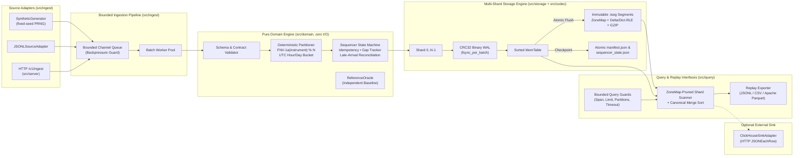

# Architecture — Distributed Tick Data Database

## 1. Component Overview

The prototype strictly separates **source adapters**, **pure domain contracts & sequence state transitions**, **durable sharded storage**, and **bounded query/replay interfaces**.

## 2. Data Flow

1. **Ingestion & Backpressure:** Producers submit batches (`[]RawTick`) to `ingest.Pipeline`. The bounded channel (`queue_capacity_batches`) enforces explicit backpressure: if saturated beyond `backpressure_timeout_ms`, `ERR_BACKPRESSURE_QUEUE_FULL` is returned with a `retry_after_ms` hint. No accepted tick is ever dropped silently.
2. **Routing & Domain Validation:** `storage.Engine` routes ticks deterministically by `shard_id = FNV-1a-32(instrument_id) % num_shards`. Each shard executes the pure `domain.Sequencer` state machine:
   - Enforces canonical schema validation (`schema_version == "1.0.0"`, UTC epoch nanosecond bounds, non-crossed quotes, positive trade price/size, monotonic sequence `>= 1`).
   - Checks `(source_id, instrument_id, sequence_number)` idempotency via payload digest (`SHA-256` prefix): identical retries are deduplicated (`duplicate_count++`); conflicting payloads on an existing sequence are rejected (`ERR_DUPLICATE_SEQUENCE_CONFLICT`).
   - Detects forward sequence jumps and tracks exact open gap intervals `[start_seq, end_seq]`.
   - Reconciles late arrivals by filling, narrowing, or splitting open gap intervals, tagging accepted late ticks with `late_arrival = true`, or rejecting beyond watermark lag under `reject_too_late`.
   - Stamps `ingest_time_ns`, `batch_id`, `shard_id`, and `partition_key` (derived from `event_time_ns`, never `ingest_time_ns`).
3. **Durable Commit (WAL):** Before acknowledging a batch, each shard encodes accepted ticks into a binary WAL frame prefixed with magic `"TWAL"`, frame length, and `CRC32-IEEE` checksum, and invokes `fsync` (in `fsync_per_batch` mode). If WAL append fails, in-memory sequencer state rolls back to its pre-batch snapshot.
4. **Atomic Columnar Flush:** When `len(memtable) >= memtable_max_events` or `wal_size >= max_segment_bytes`, memtable ticks are grouped by UTC time bucket, sorted in canonical order `(event_time_ns, instrument_id, source_id, sequence_number)`, encoded into columnar `.tseg` files (Delta-of-Delta timestamps/sequences, Delta prices, Varint sizes, Dictionary+RLE strings, Byte-RLE enums/flags, GZIP block compression, CRC32 payload checksum, uncompressed ZoneMap header), written via `.tmp` + `fsync` + atomic `rename`, recorded in `manifest.json` + `sequencer_state.json`, and the WAL is truncated.
5. **Crash Recovery:** On startup (`storage.OpenShard`), manifest and checkpointed sequencer state load first; the WAL is scanned frame-by-frame. Any truncated or CRC-mismatched trailing frame (partial batch write) is explicitly detected and either truncated safely (when `truncate_corrupt_tail_on_recovery: true`) or surfaced as `ERR_WAL_CORRUPT_TAIL`. Only after WAL validation succeeds are orphaned `.tmp` files cleaned up. Committed WAL frames newer than `manifest.LastWALSeq` are replayed through both the sequencer and memtable.
6. **Bounded Range Query & Replay Export:** `query.Service` validates range duration, row limit, partition scan budget, and timeout before scanning disk. When `instrument_id` is specified, only the owning shard is queried. Segments outside the requested time buckets or failing ZoneMap min/max/instrument predicates are skipped without decompressing. Results are merged in canonical order, paginated via `PageCursor`, and exportable to `jsonl`, `csv`, or spec-compliant Apache Parquet 1.0 (`PAR1` + Thrift Compact Protocol + GZIP data pages).

## 3. Core Invariants

1. **No silent loss of acknowledged ticks:** A batch returns success to the caller only after its WAL frame is durably written and synced.
2. **Idempotency across restarts:** Persisted `sequencer_state.json` + WAL replay preserve seen sequence digests and open gap intervals across restarts.
3. **Deterministic canonical ordering:** Query and replay outputs are totally ordered by `(event_time_ns, instrument_id, source_id, sequence_number)`, matching the naive in-memory `ReferenceOracle` with zero deviation.
4. **Bounded resource usage on read and write:** Both ingestion queues and query scan budgets/limits are explicitly bounded and return structured machine-readable errors when exceeded.

## 4. Trade-offs & Scope Limitations

- **Single-node multi-shard topology:** Local execution validates sharding, routing, WAL durability, columnar compression, and merge-query semantics across N shards on one host. It is **not** evidence of distributed multi-host linear scalability, network-partition tolerance, or consensus replication.
- **In-memory dedup digest table:** `StreamState.SeenDigests` retains exact per-sequence digests for exact conflict detection in this prototype. Production long-retention deployments would bound this map by time window / Bloom filter + backing index.
- **No segment compaction daemon:** Immutable segments per flush remain separate within each hourly bucket; a background compaction pass merging small segments into larger sorted runs would further optimize long-running workloads.
- **See also:** [ADR 0001: Partitioning, Compression, and Storage Engine](adr/0001-partitioning-compression-and-storage-engine.md).
