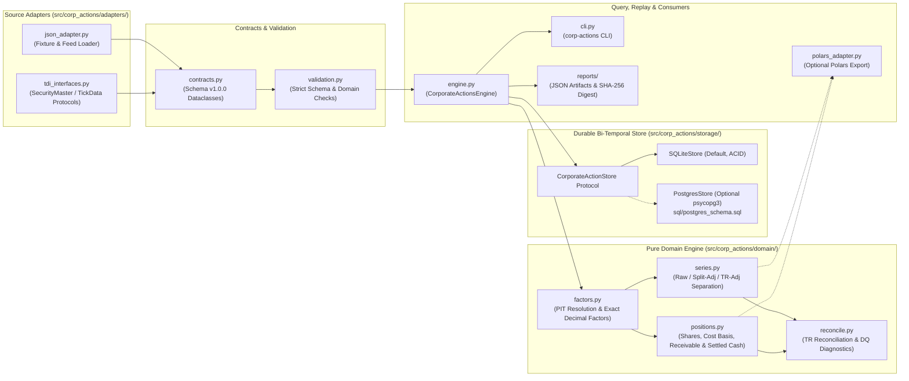
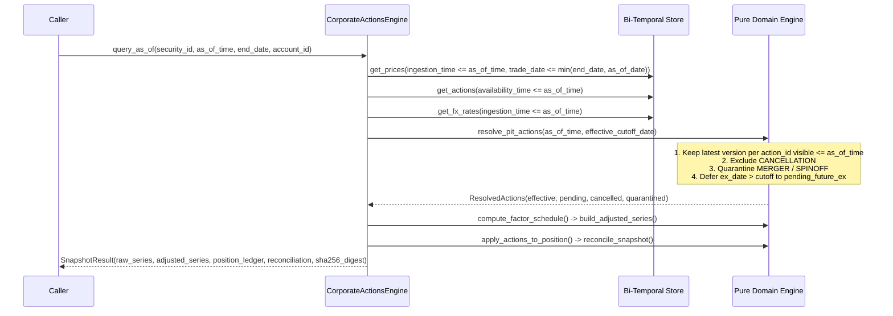

# Architecture — Financial Corporate Actions Engine

## 1. Component Architecture

The engine enforces strict boundaries between **source ingestion adapters**, **canonical versioned data contracts**, **durable bi-temporal storage**, **pure side-effect-free domain transitions**, and **point-in-time (PIT) query/replay orchestration**.

## 2. Bi-Temporal Data Flow & No-Hindsight Invariants

Every input record carries explicit temporal metadata in UTC:

1. **Event / Effective Time** (`trade_date`, `ex_date`, `pay_date`, `event_time`): When the economic event occurs in the market.
2. **Ingestion Time** (`ingestion_time`): When the engine persisted the record.
3. **Availability / Knowledge Time** (`availability_time` on corporate actions): When the action revision became known to downstream consumers.

## 3. Core Invariants

| Invariant | Guarantee | Enforcement Location |
|---|---|---|
| **No hindsight (PIT)** | No action revision with `availability_time > as_of_time`, nor market bar with `ingestion_time > as_of_time`, can influence a snapshot. | `SQLiteStore.get_*`, `resolve_pit_actions()` |
| **No premature ex-date adjustment** | Announced actions with `ex_date > min(end_date, as_of_time.date())` are reported in `diagnostics.pending_future_ex_actions` and never distort historical prices before ex-date. | `resolve_pit_actions()` |
| **Raw vs. adjusted separation** | Raw unadjusted OHLCV bars (`raw_series` and `raw_*` fields) are never mutated; split-adjusted (`split_adj_*`) and total-return adjusted (`tr_adj_*`) series are emitted in separate fields. | `build_adjusted_series()` |
| **Exact Decimal arithmetic** | All ratios, prices, factors, quantities, FX conversions, taxes, and cash flows use Python `decimal.Decimal` (`prec=28`, `ROUND_HALF_EVEN`) and are stored as exact `TEXT` (SQLite) or `NUMERIC` (PostgreSQL). | `factors.py`, `positions.py`, `sqlite_store.py` |
| **Explicit handling of unsupported actions** | `MERGER` and `SPINOFF` are never silently applied or dropped: they produce structured `QuarantineRecord`s + structured JSON warning logs (or raise `UnsupportedActionError` when `strict_unsupported_actions=True`). | `resolve_pit_actions()`, `validation.py` |
| **Deterministic same-day ordering & conflict detection** | Compatible same-day actions execute in canonical order (`SYMBOL_CHANGE` -> `SPLIT`/`REVERSE_SPLIT` -> `CASH_DIVIDEND` -> `SPECIAL_DIVIDEND`). Duplicate unlinked splits or symbol changes on the same `(security_id, ex_date)` raise `SameDayConflictError`. | `ACTION_PRECEDENCE`, `_validate_same_day_actions()` |
| **Total-return reconciliation** | Compounded reinvested-at-ex-open gross portfolio return matches the total-return adjusted close series return within `config.reconciliation_tolerance` (`1e-6`). | `reconcile_snapshot()` |

## 4. Key Trade-offs

- **Backward adjustment vs. forward adjustment**: Uses the CRSP / S&P backward-adjustment convention (most recent bar has cumulative factor `1.0`, older prices are scaled backward). Trade-off: historical adjusted prices change when new ex-dates occur, which is mitigated by immutable PIT snapshots and deterministic replay diffs (`replay_correction`).
- **Gross dividend factor vs. net position cash**: Adjustment factors follow standard market-index convention using gross dividends (matching observed raw price ex-date drops), while position cash ledgers deduct configurable `tax_withholding_rate` to track exact investor net cash receivables and settlements.
- **Zero-dependency embedded SQLite default vs. PostgreSQL**: Ships with stdlib `sqlite3` so any developer can run tests, demos, and durable restart-safe persistence out of the box, while keeping `PostgresStore` + `sql/postgres_schema.sql` behind the identical `CorporateActionStore` protocol for multi-writer deployments.
