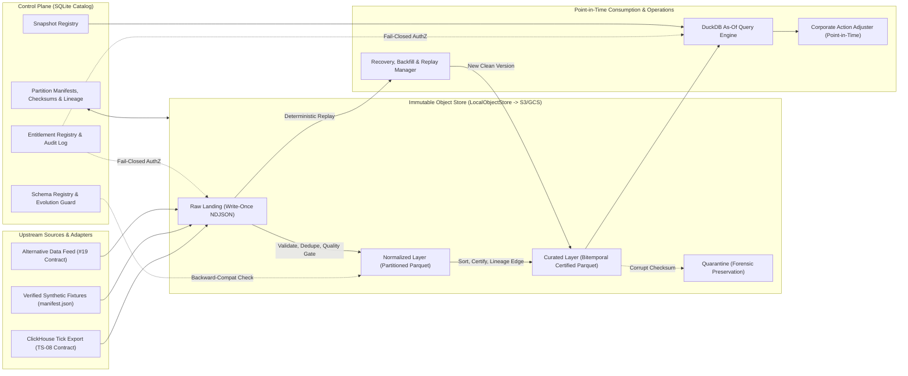

# Financial Data Lake — Architecture

## Overview

The Financial Data Lake is a versioned, point-in-time (bitemporal) market data platform designed for reproducible quantitative research, backtesting, and auditability. It separates immutable object storage from catalog metadata, entitlement authorization, schema evolution, data quality enforcement, and analytical querying.

## System Diagram



## Component Boundaries

| Component | Module | Responsibility & Boundary |
|---|---|---|
| Domain Contracts & Config | `models.py`, `config.py`, `errors.py` | Immutable Pydantic domain contracts with explicit UTC `event_ts`/`available_at`, units, currencies, versioned config (no secrets), and structured errors. |
| Schema Registry | `schemas.py` | Versioned Arrow schemas (`v1`, `v2`, ...); permits backward-compatible additive/widening changes and rejects breaking drops, narrowings, or non-nullable additions without defaults. |
| Catalog & Entitlement Registry | `catalog.py` | SQLite WAL database enforcing fail-closed dataset entitlements (role, purpose, license window, zero-redistribution), audit logging, partition manifests, checksums, lineage edges, quality reports, and snapshot manifests. |
| Immutable Object Store | `storage.py` | Write-once local object store abstraction (`ObjectStore` protocol) with atomic temporary-file writes, SHA-256 verification on read, and forensic quarantine copying. |
| External Adapters | `adapters/clickhouse.py`, `adapters/fixture_loader.py` | Isolates upstream wire formats (ClickHouse MergeTree `JSONEachRow` tick exports and manifest-verified fixture files) from core lake business logic. |
| Medallion Ingest & Quality | `ingest.py`, `quality.py` | Idempotent ingestion (`raw -> normalized -> curated`), within-batch and cross-batch deduplication, quality gates (nulls, UTC bitemporal order, primary key uniqueness, OHLC/split invariants, revision monotonicity), and lineage recording. |
| As-Of Query & Snapshots | `query.py` | DuckDB analytical engine enforcing `available_at <= as_of_ts`, selecting the latest revision available at `as_of_ts`, computing lookahead-free split/dividend adjustments, and pinning/reproducing immutable snapshots. |
| Recovery, Backfill & Retention | `recovery.py` | Partition integrity scanning, corrupt partition quarantine + deterministic recovery from immutable raw landing, full dataset replay, idempotent backfill, and non-destructive cold-tier retention evaluation. |

## Storage Layout

```text
<lake_root>/
  catalog.sqlite3
  object_store/
    raw/<dataset_id>/ingest_date=<YYYY-MM-DD>/v<N>_<run_id>_<sha12>.jsonl
    normalized/<dataset_id>/<partition_key>=<val>/v<N>_<run_id>.parquet
    curated/<dataset_id>/<partition_key>=<val>/v<N>_<run_id>.parquet
    snapshots/<name>_<snapshot_id>.json
    quarantine/<original_relative_path>
```
