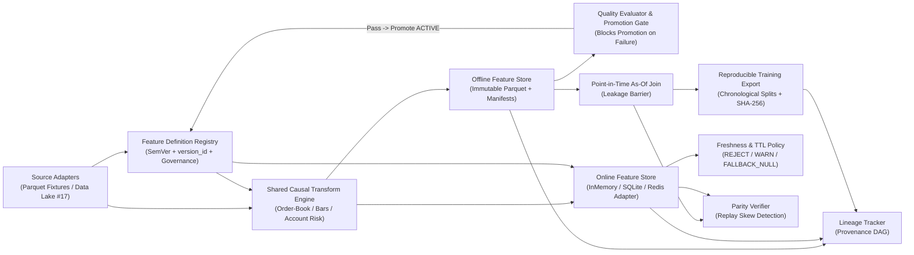

# Architecture — Financial Feature Store

## 1. System Overview

The Financial Feature Store enforces **bi-temporal causality** (`event_time <= availability_time <= query_time`) and **training/serving parity** by routing both offline batch materialization and online serving through the exact same deterministic causal transform kernel and versioned registry contracts.

## 2. Component Boundaries

| Component | Module | Responsibility | Isolation / Failure Mode |
|---|---|---|---|
| Domain Contracts & Errors | `contracts.py`, `errors.py` | Frozen Pydantic v2 models, UTC enforcement, SHA-256 `version_id`, structured error codes | Rejects naive timestamps, `availability_time < event_time`, invalid SemVer |
| Feature Definition Registry | `registry.py` | Canonical versioned registry, SemVer schema evolution, anti-proliferation budgets, promotion gating | `ImmutableVersionError`, `FeatureProliferationError`, `SchemaCompatibilityError`, `QualityGateError` |
| Shared Causal Transforms | `transforms.py` | Pure deterministic causal kernels for LOB microstructure, market bars, and account risk velocity | `LeakageViolationError` on non-causal lag, `NullPolicyViolationError` under `REJECT` |
| Source Adapters | `adapters/sources.py` | Isolates external file/provider loading, SHA-256 verification, entitlement metadata, synthetic generators | `AdapterError` on missing file or corrupted checksum |
| Offline Feature Store | `offline.py` | Versioned Parquet materialization, bi-temporal point-in-time joins, idempotent backfill, training dataset export | `LeakageViolationError`, `VersionMismatchError`, `BackfillError`, `ExportError` |
| Online Serving & Backends | `online.py`, `adapters/online_backends.py` | Low-latency KV lookups behind `OnlineBackend` protocol (InMemory, SQLite, Redis adapter), freshness & TTL enforcement | `StaleFeatureError`, `VersionMismatchError`, `LeakageViolationError`, `QualityGateError` |
| Quality & Lineage | `quality.py` | Automated data quality rules, promotion gating, directed provenance DAG | Failed checks block `ACTIVE` promotion and online sync |
| Parity Verifier | `parity.py` | Chronological replay harness comparing offline point-in-time joins vs online served vectors | Produces structured `ParityReport` with exact `ParityDiffDetail` diagnostics |

## 3. Bi-Temporal Point-in-Time Semantics

Every observation carries two mandatory UTC timestamps:
- **`event_time`**: When the underlying market or account event occurred.
- **`availability_time`**: When the event became known/ingested and legally usable by the feature store (`availability_time >= event_time`).

A point-in-time query for `(entity_id, as_of_time)` strictly filters candidates to:
1. `event_time <= as_of_time` (blocks future events)
2. `availability_time <= as_of_time` (blocks late-arriving data before it was actually known)

Among eligible candidates, the store selects the record maximizing `(event_time, availability_time, materialized_at)`. No backward/future fill is ever permitted.

## 4. Upstream & Downstream Integration Boundaries

- **Upstream (#17 Financial Data Lake, #19 Alternative Data)**: Integrated exclusively via `FeatureSourceAdapter` returning `(pl.DataFrame, SourceDatasetContract)` with mandatory UTC `event_time`, `availability_time`, `source_version`, `schema_hash`, `entitlement`, and `license`.
- **Downstream (#22 Low-Latency ML Inference, #23 MLOps / Governance)**:
  - Offline training consumes `TrainingDatasetManifest` + checksummed Parquet exports with verified chronological `train`/`val`/`test` splits and exact `version_id` pins.
  - Online inference consumes `OnlineFeatureVector` with explicit `freshness_status`, `age_seconds`, `is_stale`, and `version_id`.
