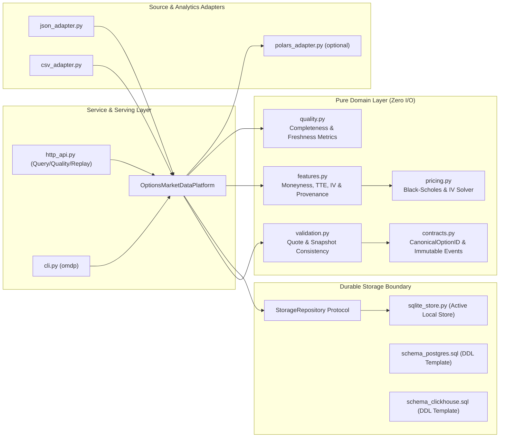

# Architecture — Options Market Data Platform (OMDP)

## 1. System Overview and Component Boundaries

OMDP enforces a strict separation between **source adapters**, **pure domain logic**, **durable versioned storage**, and **query/replay/serving interfaces**:

## 2. Data Flow

1. **Reference Ingestion:** Contract metadata (with canonical option IDs and strike decimal scales), expiry calendars, and versioned rate/dividend curves are normalized into frozen dataclasses with SHA-256 `record_hash` digests and persisted idempotently.
2. **Underlying & Option Quote Ingestion:** Versioned quotes arrive with explicit `event_time`, `ingestion_time`, `source_id`, `source_sequence`, and `schema_version`.
3. **Snapshot Structural Consistency & Quote Validation:** `validate_and_build_chain_snapshot` enforces snapshot-level invariants (single underlying, non-empty, unique `(option_id, quote_version)`, matching `snapshot_id`) and validates each quote (expiry, strike/decimal precision, crossed/locked/negative prices, staleness, ingestion delay, supported exercise style). Validated quotes are canonically sorted and hashed into `snapshot_hash`.
4. **Feature Derivation with Provenance:** `derive_chain_features` resolves the latest quote version per option in the snapshot, pairs it with the latest non-future underlying quote and interpolated rate curve, computes ACT/365F time-to-expiry, forward price, moneyness, and Black-Scholes implied volatility/delta/vega, and attaches a `FeatureProvenance` record linking every input version and content hash.
5. **Quality Reporting & Replay:** `build_quality_report` publishes completeness, IV coverage, max staleness/delay, and flag counts. `replay_snapshot` reconstructs the chain snapshot and derived features purely from stored immutable inputs and asserts exact equality of `snapshot_hash` and sorted `feature_id` hashes.

## 3. Core Invariants

- **Bitemporal Timestamps:** Every market event records both `event_time` (venue observation time) and `ingestion_time` (platform availability time), always timezone-aware UTC.
- **Immutability & Lineage:** All domain records are frozen dataclasses with deterministic SHA-256 hashes over sorted canonical JSON.
- **No Silent Degradation:** Missing configuration, unsupported schema versions, snapshot consistency violations, arbitrage bound violations, and unsupported exercise styles fail or flag explicitly with structured error codes—never silently fabricated or dropped without trace.
- **Deterministic Replay:** Canonical quote ordering (`expiry_date`, `strike`, `option_right`, `option_id`, `quote_version`) guarantees identical `snapshot_hash` and `feature_id` outputs across process restarts and reruns.

## 4. Key Trade-offs

- **SQLite vs. PostgreSQL / ClickHouse:** See [ADR-0001](adr/0001-stack-storage-and-iv-oracle.md). SQLite enables zero-dependency offline reproducibility while `StorageRepository` and `config/schema_*.sql` keep the migration path to PostgreSQL/ClickHouse explicit.
- **European Black-Scholes Only:** Exact closed-form BSM avoids external numerical library dependencies and guarantees $< 10^{-8}$ IV round-trip accuracy, at the cost of explicitly rejecting American/Bermudan exercise styles until a binomial/PDE solver is added.
- **In-Process HTTP Dispatch + Stdlib Server:** Separating `dispatch_request` from `ThreadingHTTPServer` makes route/contract behavior 100% testable in restricted CI sandboxes while retaining a runnable HTTP server for local inspection.
