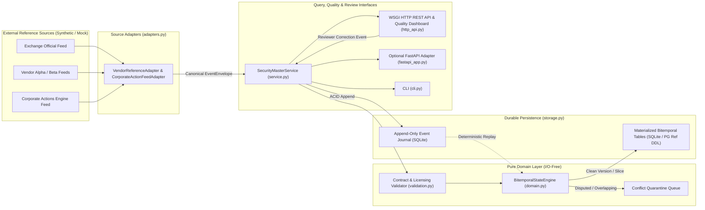

# Security Master Platform — Architecture

## 1. System Overview & Component Boundaries

The platform enforces strict separation between external source adapters, canonical event contracts, a pure I/O-free bitemporal state machine, durable event/projection persistence, and query/review interfaces.

## 2. Bitemporal Data Model & Invariants

Every entity state (`InstrumentVersion`, `ListingVersion`, `IdentifierMapping`) is indexed on two orthogonal, half-open UTC intervals:

- **Valid Time (`[valid_from, valid_to)`):** Real-world business effectiveness window (`valid_to = None` denotes open-ended `+infinity`).
- **System / Observation Time (`[observed_at, superseded_at)`):** Platform knowledge window (`superseded_at = None` denotes currently believed state).

### Core Invariants

1. **No In-Place Mutation or Deletion:** Late corrections never overwrite historical rows. Superseding an active version sets `superseded_at = incoming.observed_at` and appends new version(s) with `observed_at = incoming.observed_at`, preserving exact point-in-time reproducibility for all prior `as_of_observed` timestamps.
2. **Valid-Time Interval Continuity (Snodgrass Slicing):** When an authorized update overlaps only part of an existing version's valid window (e.g., ticker rename effective `2024-03-01` on a listing previously open-ended from `2024-01-01`), the engine automatically emits preserved carry-forward remainder slices (`[2024-01-01, 2024-03-01)`) at the new `observed_at` with full original lineage plus `supersedes_version_id`.
3. **No Silent Ambiguity Resolution:**
   - Cross-source attribute or identifier disagreements over overlapping valid windows are **quarantined** into `OPEN` `ConflictTicket`s.
   - Globally unique identifiers (`ISIN`, `OPENFIGI`, `COMPOSITE_FIGI`, `MIC_TICKER`) cannot map to two distinct canonical instruments/listings in overlapping valid windows.
   - Ambiguous bare-ticker queries across dual listings raise `AMBIGUOUS_MAPPING` (`409`) enumerating all candidate `(instrument_id, listing_id, mic, currency)` records.
   - Active lookups touching an `OPEN` conflict ticket raise `CONFLICT_BLOCKED` (`409`) until a reviewer records an audited `REVIEW_CORRECTION` event.
4. **No Hindsight Bias (Pre-Observation Boundary):** If records cover `as_of_valid` in valid time, but all matching versions have `observed_at > as_of_observed`, lookup explicitly raises `PRE_OBSERVATION_LOOKUP` (`422`) with `earliest_observed_at` rather than silently returning "not found" or leaking future knowledge.
5. **100% Lineage Retention:** Every version carries `source_system`, `source_event_id`, `schema_version`, optional `supersedes_version_id`, and—for reviewer-resolved records—`reviewer_id`, `review_rationale`, and `conflict_id`.
6. **Deterministic Replayability:** All state derives purely from ordered `event_journal` replay. Replaying the journal produces an identical SHA-256 `snapshot_hash`.

## 3. Architectural Trade-Offs

| Decision | Chosen Design | Trade-Off |
|---|---|---|
| **Domain isolation** | Pure Python in-memory state engine (`domain.py`) hydrated from durable SQLite event journal (`storage.py`) | Instant deterministic unit testing and ~20k+ ev/s replay; single-node memory footprint scales linearly with total version history (appropriate for research prototype; large multi-million-row universes would push bitemporal indexing directly into PostgreSQL `tstzrange` GiST). |
| **Per-event materialized sync** | `SecurityMasterService.ingest_event` atomically appends to `event_journal` and syncs SQLite materialized tables | Guarantees immediate SQL inspectability and crash consistency per write; lowers single-event durable SQLite throughput (~494 ev/s measured) compared to pure memory (~33k ev/s) or batched replay (~20.8k ev/s). |
| **Strict conflict quarantine** | `policy = "quarantine_all"` (only same-source explicit corrections or `REVIEWER_WORKFLOW` supersede active records) | Eliminates silent mis-mappings at the cost of requiring reviewer intervention when two vendors disagree. |
| **Zero-dependency HTTP + optional FastAPI** | Stdlib WSGI server (`http_api.py`) + optional FastAPI wrapper (`fastapi_app.py`) | Runs reproducibly in air-gapped/offline environments with zero external installs while keeping FastAPI OpenAPI compatibility. |
